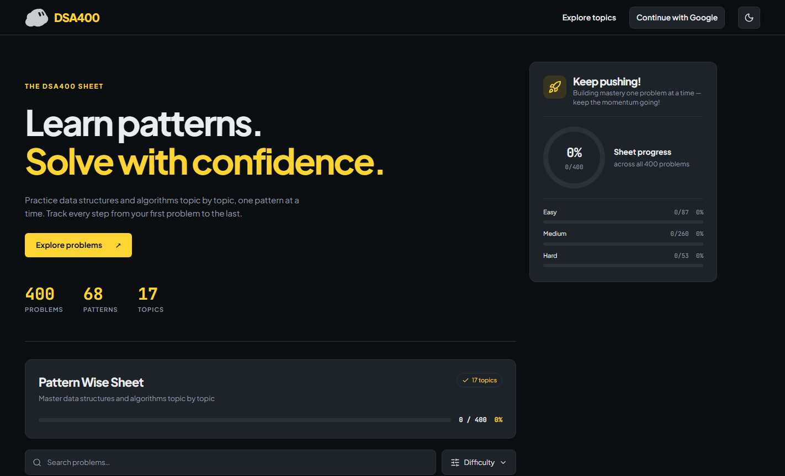
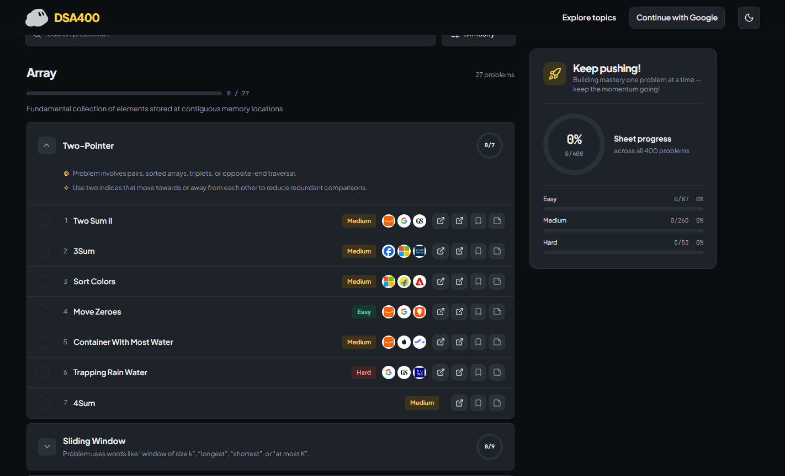

# DSA400 — Learn patterns. Solve with confidence.

**400 problems · 68 patterns · 17 topics**

Practice data structures and algorithms one pattern at a time. Find a problem, work through it, and see your progress grow. **Free to explore; no account required to get started.**

### [🚀 Open the live DSA400 sheet](https://dsa400.vercel.app/sheet)

## Take a look

*The sheet at a glance: topics, pattern counts, and progress by difficulty.*

*Open a pattern to see its practice problems, difficulty, and helpful links.*

## Why try DSA400?

- **A clear path:** 400 problems organized into 68 patterns across 17 topics.
- **Practice at your pace:** Search problems and filter by Easy, Medium, or Hard.
- **See your progress:** Mark problems complete and follow your overall and difficulty-level totals.
- **Stay organized:** Bookmark problems, add notes, and switch between light and dark themes.
- **Pick up where you left off:** Sign in with Google to save completed problems to your account. If you stay signed out, completion progress is stored in your browser instead. Guest checkmarks are not automatically transferred to an account.

## Get started

1. [Open DSA400](https://dsa400.vercel.app/sheet).
2. Choose a topic and expand a pattern.
3. Solve a problem, mark it complete, and keep going.

> This repository shares information and screenshots for the live site. It does **not** contain the website source code.
